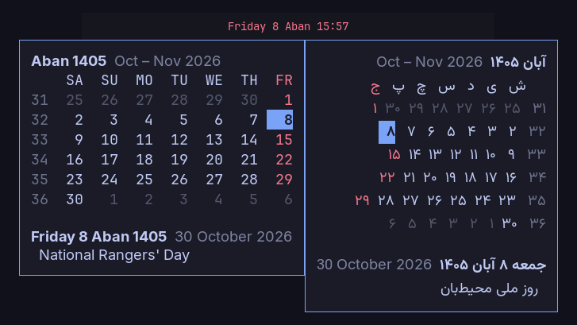
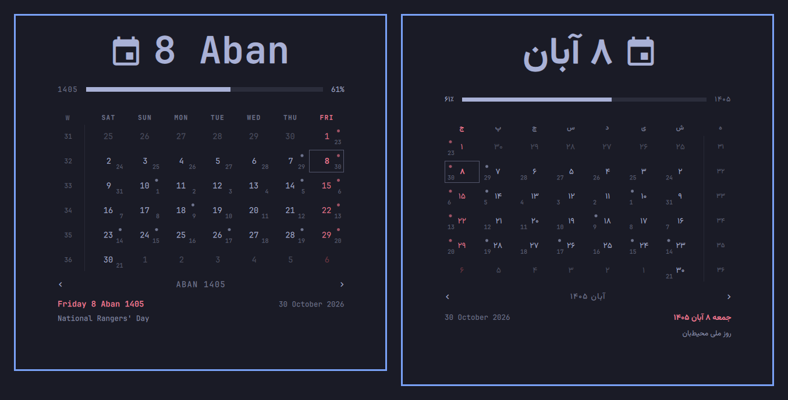

# Jalali Calendar

[](https://github.com/AryanHamedani/jalali-calendar/actions/workflows/test.yml)
[](https://github.com/AryanHamedani/jalali-calendar/releases)
[](LICENSE)

The Persian (Jalali, Shamsi) calendar for your Linux desktop bar and your
terminal, with Iran's official holidays and occasions, lunar ones included.
English by default; Persian, right to left with Persian digits, is one option
away.



- **A date label** in the format you choose: `Friday 8 Aban 14:30`,
  `1405/08/08`, `جمعه ۸ آبان`.
- **A month grid** starting on Saturday, with week numbers, Fridays and
  official holidays in red, and today marked.
- **Occasions for every day**: national (Nowruz, Yalda, Mehregan…), religious
  (Eid al-Fitr, Ashura…) and international, from time.ir's official calendar.
- **No network, no services.** Everything ships with it.

## Where it runs

It is one calendar core with three ways to use it:

| Desktop | Front end | What you get |
|---|---|---|
| **Waybar**, on Hyprland, Sway, niri, river or any wlroots compositor | `waybar/` module | The date label; hover for the month with holidays and today's occasions; scroll through months, click to come back. |
| **Omarchy** | `omarchy/` shell widget | Takes the stock clock's place with a full popup calendar, year progress and occasions for the day under the pointer. |
| **Terminal**, or any other bar | `jalali-calendar` | `today`, `date`, `convert`, a `cal`-style `month`, and the Waybar JSON for bars that read it. |



## Install

```bash
curl -fsSL https://raw.githubusercontent.com/AryanHamedani/jalali-calendar/main/install.sh | bash
```

Run the same command to update. On Omarchy it adds the shell widget (add
`… | bash -s -- --replace-clock` to put it in the stock clock's slot, keeping
the clock's settings). Anywhere else it puts `jalali-calendar` in
`~/.local/bin` and the Waybar module in `~/.config/waybar/`, then prints the
two lines to add to your Waybar config:

```jsonc
"include": ["~/.config/waybar/jalali-calendar.jsonc"],
"modules-center": ["custom/jalali"],
```

and `@import "jalali-calendar.css";` at the top of `style.css`. Either way it
installs the Vazirmatn font when it can, for Persian mode. It needs Python 3
and git (and on Omarchy, nothing beyond what Omarchy has).

## Use

```console
$ jalali-calendar
Friday 8 Aban 1405
$ jalali-calendar date 'dddd d MMMM yyyy HH:mm' --language fa
جمعه ۸ آبان ۱۴۰۵ ۱۴:۳۰
$ jalali-calendar convert 2026-10-30
1405-08-08
$ jalali-calendar convert 1405/01/01
2026-03-21
$ jalali-calendar month          # or: month 1405 1
   Aban 1405  Oct – Nov 2026
    SA  SU  MO  TU  WE  TH  FR
31  25  26  27  28  29  30   1
32   2   3   4   5   6   7   8
…
  8  National Rangers' Day
```

| Waybar | Omarchy | Does |
|---|---|---|
| Hover | Click | The month, with today's occasions |
| Scroll | Scroll, `←` `→` | Previous / next month |
| Click | `T` | Back to this month |
| | Right-click | Next label format |
| | `W` | Start weeks on Monday / Saturday |

## Configure

**Waybar** takes options on the module's `exec` line:

```jsonc
"exec": "jalali-calendar waybar --format 'dddd d MMMM HH:mm' --language en --week-start saturday"
```

| Option | Default | Meaning |
|---|---|---|
| `--format` | `dddd d MMMM HH:mm` | The label; add `"interval": 1` if it shows seconds |
| `--language` | `en` | `fa` for Persian, right to left |
| `--week-start` | `saturday` | First column of the grid |
| `--holiday-color` | `#f7768e` | Fridays and holidays in the tooltip |
| `--today-color` | `#7aa2f7` | Today's highlight in the tooltip |

The label's CSS gets the class `holiday` on Fridays and official holidays.
Scrolling redraws the module through Waybar signal 9; if another module
already uses it, change `"signal"` in the module and set
`JALALI_CALENDAR_SIGNAL` to match.

**Omarchy** reads settings from the widget's entry in `~/.config/omarchy/shell.json`:

| Setting | Default | Meaning |
|---|---|---|
| `format` | `dddd HH:mm` | Bar label |
| `formatAlt` | `d MMMM yyyy` | Extra format in the right-click ring |
| `verticalFormat` | `HH\n—\nmm` | Label on a vertical bar |
| `language` | `en` | `fa` for Persian, right to left |
| `fontFamily` | `Vazirmatn` | Face for Persian text |
| `weekStartDay` | `saturday` | First column of the grid |
| `birthYear` | | Jalali year, for the memento mori rail (double-click the year bar) |
| `lifeExpectancy` | `90` | Years that rail measures against |

**Formats** read like Qt's date formats, but name the Jalali date:

| Token | Means | Example |
|---|---|---|
| `d` `dd` | Day of month | `5` `05` |
| `ddd` `dddd` | Weekday | `Tue` `Tuesday` |
| `M` `MM` | Month number | `8` `08` |
| `MMM` `MMMM` | Month name | `Aba` `Aban` |
| `yy` `yyyy` | Year | `05` `1405` |
| `H` `HH` `h` `hh` | Hour, 24 or 12 | `14` `2` |
| `mm` `ss` | Minute, second | `30` `09` |
| `AP` | AM / PM | `PM` |
| `'text'` | Literal text | |

## Holidays and occasions

Solar dates never move, but lunar ones are fixed each year by moon sighting,
so no formula reproduces the official calendar, and this one does not guess.
It ships time.ir's official list for each year; a year without its file still
shows every solar occasion and holiday and leaves the lunar ones out.

The bundled years are 1404, 1405 and 1406. A new year arrives with an
update, usually before Nowruz, or add one yourself (needs `curl` and `jq`):

```bash
bin/fetch-events 1407
```

The data comes from:

- **time.ir**, by way of [holidayapi.ir](https://holidayapi.ir): the official
  holiday roster and the lunar occasions (`events/<year>.json`).
- **[Iran-calendar-events](https://github.com/5adra/Iran-calendar-events)**
  (MIT): national and international occasions (`events/national.json`,
  `events/international.json`); its license is in `events/LICENSE.5adra`.
- English titles for all of them: `events/en.json`.

## Uninstall

```bash
rm -rf ~/.local/share/jalali-calendar ~/.local/bin/jalali-calendar ~/.config/waybar/jalali-calendar.{jsonc,css}
# Omarchy: omarchy plugin remove io.github.aryanhamedani.jalali-calendar --yes
#          and put omarchy.clock back into bar.layout if you replaced it
```

## Contributing

```
lib/jalali.py        the calendar core in Python: conversion, formats, occasions, grids
lib/Model.js         the same core in JavaScript, for the Omarchy widget
bin/jalali-calendar  the command: terminal output and the Waybar module
bin/fetch-events     rebuilds events/<year>.json from time.ir
events/              holiday and occasion data, one file per Jalali year
waybar/              Waybar module and style
omarchy/             Omarchy shell widget (QML); manifest.json is its entry
tests/               test_jalali.py (Python), model-test.js (JavaScript)
install.sh           one-command install / update
```

The two cores are kept identical by test: `tests/test_jalali.py` runs
`Model.js` under node and compares every day from 1300 to 1500, formatted
dates in both languages, and every month grid with its holidays for the
bundled years. `tests/model-test.js` also checks the conversion against ICU's
Persian calendar, an independent implementation.

```bash
python3 -m unittest discover -s tests
node tests/model-test.js
```

Change a core, change both. New occasion names need an English title in
`events/en.json` (CI fails when one is missing). Pull requests welcome,
especially corrections to occasion names and translations.

## License

MIT. The Jalali conversion follows the break-table algorithm of
[jalaali-js](https://github.com/jalaali/jalaali-js) (MIT). The Omarchy widget
builds on Omarchy's own clock (MIT).
